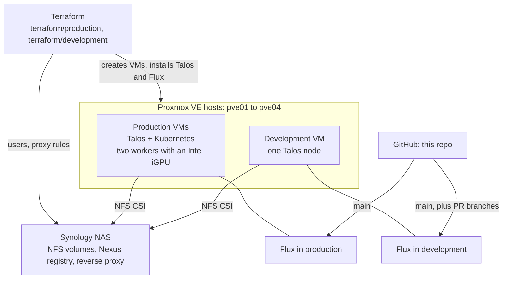
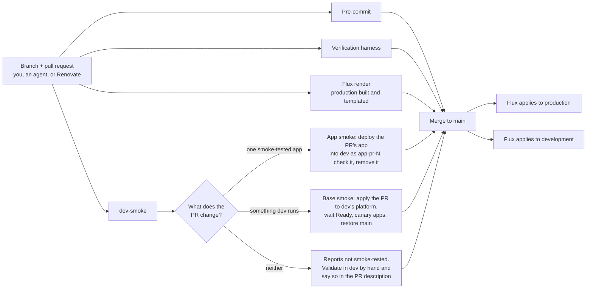
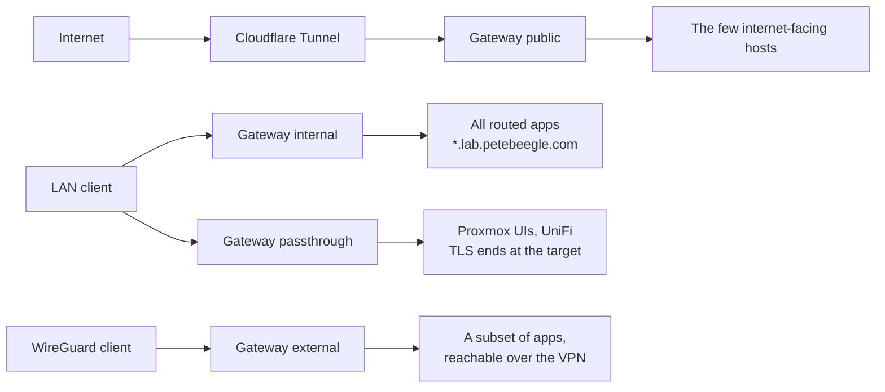
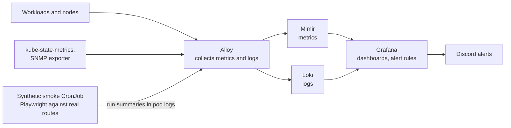

# Overview

What this repo is, how the pieces fit, and where to look for a given task.
This page is written by hand. For the generated inventory of every Flux
Kustomization, HelmRelease, route and Terraform resource, see
[architecture.md](./architecture.md).

## The short version

This repo is the single source of truth for two Kubernetes clusters that run on
Proxmox VMs with Talos OS. Terraform builds the VMs and bootstraps Talos and
Flux. From then on, Flux applies whatever is on `main`.

- **Production** runs the apps and a full monitoring stack.
- **Development** is one node. It runs a handful of apps and exists to test
  changes before they merge. Pull requests are deployed into it by CI.

| Directory | What it holds |
|-----------|---------------|
| `terraform/` | VMs, Talos bootstrap, Flux bootstrap, plus Grafana and Synology config under `terraform/external/` |
| `kubernetes/clusters/<cluster>/` | The Flux entrypoint for each cluster: which infra and apps it activates |
| `kubernetes/infra/` | Shared platform manifests: networking, storage, secrets, monitoring, controllers |
| `kubernetes/apps/` | Shared app manifests. `branch/` subfolders are overlays used for PR environments |
| `tools/` | The branch-environment verifier, CI helpers, policy checks and their tests |
| `tests/browser/` | Playwright checks used by the smoke gate |
| `.github/workflows/` | CI checks, the `dev-smoke` gate, cleanup and heartbeat |
| `docs/` | This page, decisions, runbooks |

## The platform



Node counts and sizes live in `terraform.tfvars`, which is not in git. Talos
nodes have no SSH; everything goes through `talosctl`. Terraform state is in an
S3 bucket on the NAS ([Terraform state](./runbooks/terraform-state.md)).

## What runs where

| Layer | Production | Development |
|-------|------------|-------------|
| Networking | Cilium, Gateway API, cert-manager, WireGuard VPN | Cilium, Gateway API, cert-manager |
| Storage | NFS CSI to the NAS, local-path, CloudNativePG | Same three |
| Secrets | SOPS for workloads, with the 1Password operator installed alongside | 1Password operator |
| Identity | Authentik | None |
| Monitoring | Alloy, Mimir, Loki, Grafana, Discord alerts, synthetic smoke tests, and the `public-heartbeat` workflow from outside | None. The `dev-heartbeat` workflow stands in |
| Apps | homepage, pihole, whoami, jellyfin, immich, home-assistant, foundryvtt, valheim, access-broker, cloudflare-tunnels, renovate, synthetics, external routes | whoami, homepage, and the `dev-runner` account the CI runner acts as |
| CI | Actions Runner Controller and the `homelab-dev` runner, one ephemeral pod at a time, fenced off from production ([decisions](./decisions.md#changes-go-through-pull-requests-and-the-check-is-the-evidence)) | None; the production runner drives it from outside |

## How a change reaches production



Nothing is committed to `main` directly. An app is smoke-tested when it has a
profile with `prSmoke: true` in `tools/development/smoke-profiles/` and an
overlay in `kubernetes/apps/<app>/branch/`. Any other change to something the
development cluster runs gets the base smoke. Both run on the CI runner in
production, which drives development from outside. The rule is
in [decisions.md](./decisions.md#changes-go-through-pull-requests-and-the-check-is-the-evidence); the procedure is
[change-workflow.md](./runbooks/change-workflow.md).

Three workflows support the gate, and one watches production from outside:

| Workflow | When | What it does |
|----------|------|--------------|
| `dev-smoke` | Every PR | Classifies the change, then deploys and tests it in development if it can; also removes stale PR environments |
| `dev-cleanup` | Scheduled every 30 minutes (GitHub fires it far less often) | Removes PR environments that outlived their run |
| `dev-heartbeat` | Scheduled hourly (likewise sparse) | Checks the development cluster and runner are alive, since nothing else monitors them |
| `public-heartbeat` | Scheduled twice an hour (likewise sparse) | Requests the internet-public hosts from outside, so a dead production or tunnel is noticed even though production's own alerting is down with it ([synthetic smoke](./runbooks/synthetic-smoke-tests.md#from-outside)) |

## How traffic gets in



The five gateways (`internal`, `external`, `public`, `passthrough`, `external-passthrough`) live in namespace `gateway`. There is no Kubernetes `Ingress`
anywhere; routes are `HTTPRoute` or `TLSRoute`. "External" means the WireGuard
service plane, not the internet. Internet exposure needs both a route on
`gateway/public` and a cloudflared ingress rule. Gateway addresses and pools
are set per cluster in `cluster-vars.yaml`. Development mirrors the layout
under `dev.lab.petebeegle.com`.

## How you find out something broke



Production only. The synthetic smoke job writes a summary line per run; Grafana
reads those from Loki and alerts on repeated failures. Development has none of
this stack.

## How the manifests are laid out

```text
kubernetes/
├── apps/<name>/          # one app: HelmRelease or manifests, httproute.yaml, secret
│   └── branch/           # overlay used for PR environments (smoke-tested apps)
├── infra/                # shared platform: controllers, network, authentik, monitoring
└── clusters/<env>/
    ├── kustomization.yaml, cluster-vars.yaml
    ├── infra/            # Flux Kustomizations choosing which infra this cluster runs
    └── apps/             # Flux Kustomizations choosing which apps this cluster runs
```

Shared manifests use `${variable}` placeholders instead of hardcoded values.
Each cluster has a `cluster-vars` ConfigMap that Flux injects at reconcile time
with `postBuild.substituteFrom`.

| Variable | Production | Meaning |
|----------|------------|---------|
| `cluster_domain` | `lab.petebeegle.com` | Base domain for routes (`dev.lab...` in development) |
| `cluster_env` | `production` | Environment name |
| `gateway_internal_ip`, `gateway_passthrough_ip` | `192.168.30.241`, `.242` | LAN gateway addresses |
| `gateway_external_ip`, `gateway_external_passthrough_ip` | `192.168.40.241`, `.242` | WireGuard-reachable gateway addresses |
| `gateway_internal_pool`, `gateway_external_pool` | `192.168.30.240/28`, `192.168.40.240/28` | Cilium load-balancer pools |
| `cilium_operator_replicas` | `3` | `1` in development |
| `nfs_server` | `192.168.30.99` | The NAS |
| `letsencrypt_server`, `wildcard_cert_name` | | ACME endpoint and the wildcard TLS Secret name |

Development uses `192.168.30.224/28` and `192.168.40.224/28` for its pools.

**Adding an environment:**

1. Create `kubernetes/clusters/<env>/cluster-vars.yaml` and list it in that
   cluster's `kustomization.yaml`.
2. Create `clusters/<env>/infra/` and `apps/` Flux Kustomizations with
   `postBuild.substituteFrom` and the subset you want. Use `patches:` there for
   environment-specific sizing; there are no overlay directories.
3. Bootstrap Flux at `./kubernetes/clusters/<env>`, or use the matching
   Terraform root.
4. Provide the environment's secret bootstrap (see
   [add-secret](./runbooks/add-secret.md)).

## Decisions and troubleshooting

- [decisions.md](./decisions.md): the choices that are not obvious from the
  code (PR-gated changes, Gateway API only, NFS storage and the Jellyfin
  exception, secrets, Talos and Proxmox, observability) and why.
- [troubleshooting.md](./troubleshooting.md): symptom-to-fix tables for storage,
  networking, observability and Talos.

## Runbooks by task

**Making a change**

- [Change workflow](./runbooks/change-workflow.md): branch, PR, checks, browser verification, branch protection and break glass
- [Development cluster](./runbooks/development-cluster.md)
- [Renovate](./runbooks/renovate.md)
- [CI runner](./runbooks/ci-runner.md)
- [Terraform state](./runbooks/terraform-state.md)
- [Rebuild and restore](./runbooks/rebuild-and-restore.md): what is kept where, and the order to rebuild from zero

**Adding things**

- [Add an app](./runbooks/add-app.md)
- [Add a secret](./runbooks/add-secret.md)
- [Add an Authentik proxy application](./runbooks/authentik-proxy-apps.md)
- [Cloudflare tunnels](./runbooks/cloudflare-tunnels.md)
- [Operate the 1Password operator](./runbooks/onepassword-operator.md)

**When something is broken**

- [Diagnose a Kustomization](./runbooks/diagnose-kustomization.md)
- [Diagnose a HelmRelease](./runbooks/diagnose-helmrelease.md)
- [Stabilize overloaded services](./runbooks/stabilize-overloaded-services.md)
- [Synthetic smoke tests](./runbooks/synthetic-smoke-tests.md)
- [Discord alert delivery health](./runbooks/discord-alert-delivery-health.md)
- [Verify Grafana alert rules](./runbooks/verify-grafana-alert-rules.md)
- [Observability scrape topology](./runbooks/observability-scrape-topology.md)

**Nodes, hosts and storage**

- [Upgrade Talos](./runbooks/upgrade-talos.md)
- [Proxmox no-subscription repository](./runbooks/proxmox-no-subscription-repository.md)
- [Configure NFS with Proxmox](./runbooks/configure-nfs-with-proxmox.md)
- [Resize a PVC](./runbooks/resize-pvc.md)
- [WireGuard](./runbooks/wireguard.md)

**Specific apps**

- [Home Assistant](./runbooks/home-assistant.md)
- [Immich](./runbooks/immich.md)
- [Foundry blue/green upgrade](./runbooks/foundry-bluegreen.md)
- Jellyfin: [SSO](./runbooks/jellyfin-authentik-sso.md), [GPU nodes](./runbooks/jellyfin-gpu-nodes.md), [hardware transcoding](./runbooks/jellyfin-hardware-transcoding.md)

## Known gaps

Each has an issue with the plan:

- The NAS, which holds Terraform state and app data, is not backed up (#555).
- Production runs SOPS and 1Password side by side; workloads still read SOPS
  (#490).
- The production smoke job has no outside watcher and skips some apps and the
  public path (#492).
- `dev-smoke` is informational, not yet required (#477). Renovate auto-merge
  waits for it anyway, and covers only what development deploys.
- Development runs a fraction of production, so most production changes cannot
  be rehearsed there yet.
